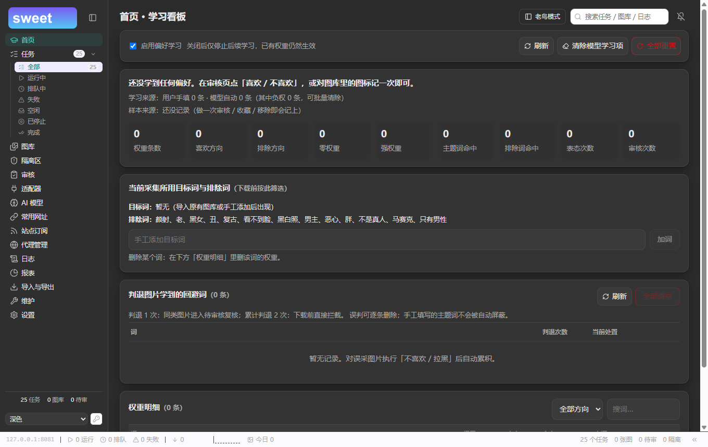

# Sweet 采集 AI 版

<p align="center">
  
</p>

**本地优先、合规优先的网页图片采集与图库管理工具。**

它把「从网站上把图收回来」做成一条可管的流水线：合规检查 → 采集 → 去重 → 本地 AI 筛选 → 人工审核 → 入库 → 检索。所有图片和判断都留在你自己的电脑上，不上传任何内容。

- 两条采集路径自动选：成熟开源下载器 gallery-dl 走主路，自研通用采集器兜底自定义站点
- 去重、AI 打分、偏好学习全部本地运行（CLIP ONNX，不联网）
- 桌面窗口 + 手机浏览器同一套界面，数据库只有一个
- 便携软件，整目录拷走即用，无需安装

---

## 功能一览

| 能力 | 说明 |
| --- | --- |
| 双路径采集 | gallery-dl 主路径 + 自研 BFS/DFS 递归发现降级路径，自动选择；自定义站点用 CSS / XPath / 正则适配器 |
| 合规门禁 | 运行前检查 robots.txt 与授权依据；遇 401/403 自动暂停请人工确认，不绕过登录墙、付费墙或验证机制 |
| 精确 + 感知去重 | SHA256 精确去重，pHash 感知去重（汉明距离 ≤ 6）；重复时保留最大那张，小的进隔离区不直接删 |
| 本地 AI 筛选 | CLIP ONNX 本地推理，对主题词打分：高分入库、不确定进审核、低分进隔离；无模型时退化为不筛选，不误杀 |
| 偏好学习 | 审核时「喜欢 / 不喜欢」累加主题词权重，用得越久判得越准；学到的排除词可一键写回任务黑名单 |
| 审核队列 | 键盘单手判定（← 不喜欢 / → 喜欢 / Ctrl+Z 撤销），支持随机抽检、智能抽样 |
| 图库与检索 | 缩略图网格、按任务/标签/站点/分数/分辨率筛选、结构化搜索语法、画面特征相似检索、批量操作 |
| 多协议导入 | 本地文件夹、WebDAV、FTP / FTPS、SFTP、SMB；支持断点续导、只索引不复制 |
| 代理与调度 | HTTP / HTTPS / SOCKS5 代理池自动选优、健康检查；优先级、并发、限速、允许时段、定时运行 |
| 数据与备份 | SQLite 单一数据库、每日自动备份、完整备份包导出/恢复、备份同步目录、开机自启、托盘常驻 |
| Web 访问 | 同一套界面在桌面窗口和浏览器里都能用，可限局域网访问、设登录密码；手机可添加到主屏幕 |
| 诊断与维护 | 日志脱敏、文件完整性检查、磁盘预警、崩溃取证、诊断包导出 |

---

## 快速开始

### 方式一：直接运行（推荐）

> **当前状态：源码已开源，便携版程序尚未发布到 Releases。** Releases 目前只有版本说明，没有打包好的可执行程序。现在要从源码运行（方式二）；等第一个便携版上传后，这里会改为直接下载。

首次运行会生成 `data/` 目录，任务、图库、配置、模型都在里面。**升级只需覆盖主程序，不要删 `data/`。**

> 本地 AI 模型文件体积较大，未随源码入库。软件首次使用 AI 功能时会在设置页提示如何获取；没有模型时其余功能照常可用。

### 方式二：从源码运行（当前可用）

```bash
# 环境：Python 3.11+
pip install -r requirements.txt

# 桌面窗口版
python mrm_app.py gui

# 无界面 + 浏览器访问版
python mrm_web_app.py
```

前端源码在 `media_resource_manager/webapp/`，改界面后重新构建：

```bash
cd media_resource_manager/webapp
npm install
npm run build
```

### 五分钟上手

1. 双击 `SweetWeb.exe` 打开软件
2. 左侧「任务」→ 新建任务，至少填一个网址，建议填主题词
3. 点保存，再点任务行的「运行」
4. 底部日志看进度，左侧「图库」看结果
5. 图库空不要急：先去「审核」放行，再去「隔离区」还原

---

## 技术栈

Python 3.11+ · PySide6（Qt 6）· httpx · BeautifulSoup4 / lxml · SQLite · Pillow / imagehash · ONNX Runtime / OpenCV（本地 CLIP 推理）· Vue 3 / Vite（Web 界面）· PyInstaller（便携打包）· gallery-dl（采集后端）

## 目录结构

```
SweetCollectorAI/
├── media_resource_manager/   # 主程序包（采集、去重、分类、审核、Web 服务、界面）
│   ├── webapp/               # Vue 3 前端源码
│   ├── web/                  # 构建后的静态资源
│   ├── resources/            # 图标与字标
│   └── ...
├── tests/                    # pytest 用例
├── docs/                     # 文档与介绍页
├── examples/                 # 适配器规则示例
├── extension/                # 浏览器扩展（可选，用于回填站点 Cookie）
├── build/                    # 打包配置
└── build_nodel.py            # 打包脚本
```

运行时数据全部落在软件目录的 `data/` 下：主数据库、配置、规则、本地模型、图库图片、待审核、隔离区、缩略图、日志。整目录拷走即可换机。

## 合规说明

这是一个通用的本地采集与图库管理工具，不预置任何站点规则，也不提供绕过网站保护措施的能力：

- 不绕过登录、付费墙、DRM、验证码或地域限制
- 采集前检查 robots.txt 并要求填写授权依据
- 请只对你有权访问的内容使用，并遵守目标网站的服务条款与当地法律
- AI 与去重全部本地运行，不上传图片或文本

## 关于作者

由一个爱好者独立开发与维护，专注本地优先、自托管的个人工具。这个软件本体开源（MIT），配套的个人适配器规则不开源。

**其他开源项目**

| 项目 | 说明 |
| --- | --- |
| [SweetReader](https://github.com/514475844/SweetReader) | 自托管个人书库与阅读器，支持 EPUB / PDF / DOC / TXT 在线阅读、全文搜索、进度记忆 |
| [SweetReader-Plugins](https://github.com/514475844/SweetReader-Plugins) | SweetReader 的插件集合 |

**联系方式**：GitHub [514475844](https://github.com/514475844) · 邮箱 514475844@163.com

问题反馈与功能建议欢迎通过 Issue 或邮件提出。

---

## 许可

MIT License — 详见 [LICENSE](LICENSE)。

gallery-dl 等依赖各自遵循其原许可。
